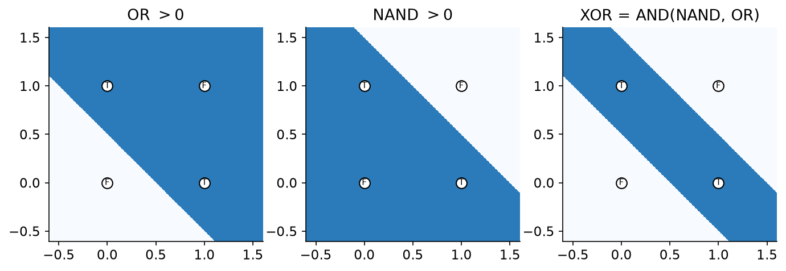
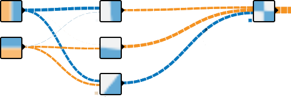
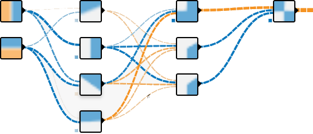

# Aktivierungsfunktionen und Universalität

## Aktivierungsfunktionen und weitere Layer

Ein Neuron „forward“ ist $\tau\langle w, x \rangle$. Beim Perzeptron ist $\tau = \operatorname{sign}$, bei der logistischen Regression $\tau = \sigma$. Allgemein ist $\tau$ beliebig – aber differenzierbar, sonst funktioniert Backpropagation nicht.

### Neues Ziel: Funktionen lernen

Bisher war das Ziel Klassifikation. Neues Ziel: Das neuronale Netz soll eine Funktion lernen (Regression), und unser Modell von der Funktion ist *stückweise linear*. Welches $\tau$ ist dafür geeignet?

:::{prf:definition} ReLU
Die *Rectified Linear Unit* ist

$$
\operatorname{ReLU}(y) := \max(0, y).
$$

Ein Neuron mit $\tau = \operatorname{ReLU}$ heißt ReLU-Neuron.
:::

**Ableitung** von $\max(0, y)$ nach $y$: Für $y > 0$ ist $\max(0, y) = y$, also ist die Ableitung $1$. Für $y < 0$ ist $\max(0, y) = 0$, also ist die Ableitung $0$. Für $y = 0$ ist die Ableitung nicht definiert – wir *definieren* sie als $0$, das spart Rechnungen. (Dass das erlaubt ist, ist genau der Inhalt von Blatt 3: schwache Ableitungen dürfen an einzelnen Punkten beliebig sein.)

**Wieso ist ReLU geeignet?** Lineare Abbildung + ReLU ist die Projektion auf einen Halbraum, denn ReLU ist genau die Projektion von $\mathbb{R}$ auf $[0, \infty)$, und ein Halbraum ist eine Seite einer Hyperebene. Ein ReLU-Neuron $\max(0, \langle w, x \rangle + b)$ ist also null auf der einen Seite der Hyperebene $\langle w, x \rangle + b = 0$ und linear ansteigend auf der anderen. Summiert man mehrere solche „Knickfunktionen“ mit Gewichten, bekommt man stückweise lineare Funktionen, deren Knickstellen auf den Hyperebenen liegen – und mit genug Neuronen kann man damit jede stetige Funktion beliebig gut approximieren. Beispiel an der Tafel; weiter unten bauen wir so von Hand $x^2$.

:::{figure} ../images/vl06-relu-sum.png
:width: 90%

Links die ReLU, rechts eine gewichtete Summe von drei verschobenen ReLUs: eine stückweise lineare Funktion mit Knicken an den Verschiebungen.
:::

### Layer, nochmal

Mehrere Neuronen, die parallel verarbeitet werden, bilden eine Schicht. Ein **Linear Layer** ist eine Matrix (Zeilen = Gewichtsvektoren) plus Bias. Ein **ReLU Layer** ist eine Schicht, in der jedes Neuron die Aktivierungsfunktion ReLU nutzt, also Linear Layer + komponentenweises ReLU. In PyTorch: `nn.Sequential(nn.Linear(n, m), nn.ReLU())`.

### Problem bei ReLU: sterbende Neuronen

Wenn ein Neuron immer $0$ liefert, weil die Eingabe immer negativ ist, „fließt“ keine Information mehr durch das Neuron während der Backpropagation – die Ableitung ist $0$, also ist $\delta$ für dieses Neuron $0$, also ändern sich seine Gewichte nie wieder. Das Neuron ist tot. Zwei Lösungen:

**Lösung 1**: Statt $\tau = \max(0, y)$ verwende $\tau(y) = f(y)[y < 0] + g(y)[y \ge 0]$ mit passenden $f, g$, sodass auch für $y < 0$ die Ableitung nicht null ist. Mit $f(y) := \alpha(e^y - 1)$ und $g(y) := y$ heißt $\tau$ **ELU** (Exponential Linear Unit); mit $f(y) := 0{,}01\,y$ heißt es Leaky ReLU.

**Lösung 2**: Statt $\max(0, y)$ verwende ein glattes $\tau$, sodass für $y \to -\infty$ gilt $\tau(y) \to 0$ und für $y \to +\infty$ gilt $\tau(y) \to +\infty$, aber ohne harten Knick:

$$
\tau(y) := y\,\sigma(y) \quad \text{(Swish, auch SiLU)}, \qquad
\tau(y) := y\,\Phi(y) \quad \text{(GELU, Gaussian Error Linear Unit)},
$$

wobei $\Phi$ die Verteilungsfunktion der Standardnormalverteilung ist. Beide sind im negativen Bereich nicht strikt null, sondern haben eine kleine Delle unter der Achse, und die Ableitung verschwindet nur asymptotisch. GELU ist heute die Standardwahl in Transformern.

Welche Aktivierungsfunktionen in der Praxis genutzt wurden, listete [paperswithcode.com/methods/category/activation-functions](https://paperswithcode.com/methods/category/activation-functions) (inzwischen nur noch im Internet Archive).

:::{figure} ../images/vl06-activations.png
:width: 90%

Aktivierungsfunktionen im Vergleich. ELU, Swish und GELU sind im negativen Bereich nicht konstant null.
:::

## Das Geheimnis um Deep Learning lüften

Warum – und wie genau – funktioniert Deep Learning so gut? Die Zutaten, die wir bisher haben:

* Das einzelne Neuron = Skalarprodukt + Aktivierungsfunktion.
* Gradientenabstieg: Lernen in Richtung der Ableitung einer Loss-Funktion.
* Backpropagation: clever die Ableitung berechnen für tiefe Netze.

Was noch fehlt, und was wir in diesem und den nächsten Kapiteln angehen:

* Sinnvolle Loss-Funktionen festlegen: Regression mit MSE, (binäre) Klassifikation mit (B)CE; BCE vs. NLL vs. $D_{KL}$.
* Architekturen neben einfachen MLPs, wie z.B. Autoencoder – und damit auch Representation Learning und Transfer Learning ([Kapitel „Autoencoder“](../part-representation-learning/09-autoencoder.md) und folgende).
* Regularisierung und Tricks gegen verschwindende Gradienten (Aktivierungsfunktionen oben, Dropout und Batch-Normalisierung im Autoencoder-Kapitel).
* Hyperparameter wählen und optimieren; alles hängt von den Daten ab …
* Und ganz grundsätzlich: Elementare Funktionen sind leicht approximierbar – das jetzt, zuerst von Hand, dann als Satz.

## Parameter von Hand wählen

Bevor wir Netze trainieren, überzeugen wir uns davon, dass die gesuchten Gewichte überhaupt *existieren*: Wir bauen kleine Netze von Hand. Das Notebook dazu ist `nn-by-hand.ipynb`.

### Easy mode: Boolesche Variablen

Seien $x, y \in \{0, 1\} = \{\text{FALSE}, \text{TRUE}\}$ und $f \colon \mathbb{R}^2 \to \mathbb{R}$, $f(x, y) := x \text{ OR } y$, also $f(0,0) = 0$, $f(1,0) = 1$, $f(0,1) = 1$, $f(1,1) = 1$. Welches neuronale Netz berechnet als Inferenz die Funktion $f$?

Idee: Schreibe $f$ als Verkettung von gewichteten Summen (= Skalarprodukten) und Aktivierungsfunktionen (z.B. $[x > 0]$ oder $\operatorname{ReLU}(x) := \max(0, x)$). Dabei müssen wir OR *interpolieren* – entscheiden, was z.B. $f(0{,}5, 0)$ sein soll – und *extrapolieren* – entscheiden, was z.B. $f(-1, 2)$ sein soll. Denn ein neuronales Netz ist auf ganz $\mathbb{R}^2$ definiert, nicht nur auf den vier Ecken.

### Easiest mode: eindimensional

Sei $x \in \mathbb{R}$ mit der Interpretation $(x \le 0) = \text{FALSE}$, $(x \ge 1) = \text{TRUE}$, und $n \colon \mathbb{R} \to \mathbb{R}$, $n(x) := \text{NOT } x$. Also $n(0) = 1$, $n(1) = 0$, allgemeiner $n(x) \le 0$ falls $x \ge 1$. Die Funktion

$$
n(x) = 1 - x
$$

erfüllt die Eigenschaft, NOT zu inter- und extrapolieren. Als neuronales Netz: 1 Neuron, Gewicht $w = -1$, Bias $b = +1$, Aktivierungsfunktion $\operatorname{id}$.

### Zurück zu OR

Ansatz: $f(x, y) = x + y$. Leider ist $f(1, 1) = 2 \neq 1$. Besser: $f(x, y) = [x + y > 0]$ – ein Neuron mit Gewichtsvektor $(1, 1)$, Bias $b = 0$ und Aktivierungsfunktion $[\,\cdot > 0]$ mit Werten in $\{0, 1\}$. Dafür ändern wir die Interpretation leicht zu $(x \le 0) = \text{F}$, $(x > 0) = \text{T}$. Softere Varianten sind $f(x, y) := x + y$ oder $\sigma(x + y)$; und noch besser, weil es Negatives sauber abschneidet:

$$
f(x, y) := \operatorname{ReLU}(x) + \operatorname{ReLU}(y).
$$

:::{figure} ../images/vl07-or-nor-heatmap.png
:width: 90%

OR und NOR als Funktionen auf ganz $\mathbb{R}^2$: Die vier Booleschen Ecken sind markiert, die schwarze Linie ist die Nullstellenmenge.
:::

### Komplizierteres aus Einfachem: NOR

Sei $g(x, y) := x \text{ NOR } y$, also $g(\text{F}, \text{F}) = \text{T}$ und sonst $\text{F}$. NOR = NOT OR, also $g(x, y) = n(f(x, y))$ für ein $f$, welches OR implementiert. Mit $f(x, y) := \operatorname{ReLU}(x) + \operatorname{ReLU}(y)$ und $n(x) := 1 - x$:

$$
g(x, y) := 1 - \bigl(\operatorname{ReLU}(x) + \operatorname{ReLU}(y)\bigr).
$$

Als Netz: erste Schicht mit Gewichten $(1, 1)$, Bias $0$ und ReLU (zwei Neuronen, eines pro Eingabe – oder eines mit Gewichtsvektor $(1,1)$, wenn man die ReLU vor die Summe zieht), zweite Schicht mit Gewicht $-1$, Bias $1$ und $\operatorname{id}$.

### Weiter so? XOR

Sei $f(x, y) := x \text{ XOR } y$. Die „Region“ XOR in der Ebene, also die Punkte $(x, y)$ mit $\text{XOR}(x, y) > 0$, ist der Schnitt von $\text{NAND}(x, y) > 0$ mit $\text{OR}(x, y) > 0$:

$$
\text{XOR}(x, y) = \text{AND}\bigl(\text{NAND}(x, y),\ \text{OR}(x, y)\bigr).
$$

Setzt man das mit den obigen Bausteinen zusammen, so müsste es mit 4 Hidden Layers zu je 4 Neuronen klappen. Gradientenabstieg mit Backpropagation findet allerdings auch Approximationen mit 3 Hidden Layers – und mit 2 Hidden Layers (siehe die Bilder `krude-xor-approximation.png` aus dem TensorFlow Playground).

:::{figure}
:width: 90%

Oben: XOR als Schnitt von NAND und OR. Unten: Vom Gradientenabstieg gefundene Approximationen im TensorFlow Playground mit 3 bzw. 2 versteckten Schichten.
:::

### Take-Home Message

Boolesche Funktionen lassen sich mit neuronalen Netzen darstellen bzw. approximieren, d.h. es gibt Gewichte, sodass die resultierende Funktion tut, was sie soll. Also kann auch Optimierung diese idealen Gewichte finden. Aus elementaren Funktionen lassen sich komplexe verknüpfen; neuronale Netze können aber auch „Abkürzungen“ nehmen und Platz verschwenden (überflüssige Neuronen).

### Arithmetik

Wie können wir z.B. $f(x, y) := x^3 + x y^2 - 3y$ mit einem neuronalen Netz berechnen oder approximieren? Einfachere Probleme, die wir dafür zuerst lösen müssen: $f(x, y) := xy$ und $f(x) := x^2$.

**Auf $[-3, +3]$ approximieren wir $x^2$** mit einer stückweise linearen Funktion an ganzzahligen Stützstellen. Die Interpolation durch die Punkte $(k, k^2)$ für $k = -3, \dots, 3$ hat auf $[k, k+1]$ die Steigung $2k + 1$, also an jeder inneren Stützstelle einen Knick, bei dem die Steigung um $2$ wächst – und jeder Knick ist eine ReLU:

$$
Q(x) = 9 - 5\,\operatorname{ReLU}(x + 3) + \sum_{k=-2}^{2} 2\,\operatorname{ReLU}(x - k).
$$

Probe: $Q(0) = 9 - 15 + 2(2 + 1) = 0$ und $Q(3) = 9 - 30 + 2(5 + 4 + 3 + 2 + 1) = 9$. Das ist ein Netz mit einer versteckten Schicht aus 6 ReLU-Neuronen (Gewicht $1$, Bias $-k$ für $k = -3, \dots, 2$) und einer linearen Ausgabeschicht mit Gewichten $(-5, 2, 2, 2, 2, 2)$ und Bias $9$. Die Symmetrie $x^2 = (-x)^2$ haben wir dabei ignoriert – geht das besser? Mit $|x|$ als erster Schicht halbiert sich die Anzahl der Knicke.

:::{figure} ../images/vl07-square-interpolation.png
:width: 90%

$x^2$ auf $[-3, 3]$ und die stückweise lineare Interpolation $Q(x)$ an ganzzahligen Stützstellen, ein Netz mit 6 ReLU-Neuronen.
:::

**Wenn $x^2$ gut approximiert werden kann, dann auch $xy$** über die Polarisationsidentität:

$$
\frac{(x + y)^2 - (x - y)^2}{4} = \frac{x^2 + 2xy + y^2 - x^2 + 2xy - y^2}{4} = xy .
$$

Damit setzen wir für eine Approximation $Q$ der Quadratfunktion

$$
\operatorname{MUL}(x, y) := \tfrac14 Q(x + y) - \tfrac14 Q(x - y),
$$

und $x + y$ sowie $x - y$ sind lineare Schichten. Mit MUL und Addition bekommen wir alle Polynome, und damit (Weierstraß) alle stetigen Funktionen auf beschränkten Bereichen.

### Take-Home Message

Funktionen lassen sich mit neuronalen Netzen darstellen bzw. approximieren. Mit einer Lookup-Table (LUT) und Interpolation sind beliebig gute Näherungen auf *beschränkten* Definitionsbereichen möglich – so rechnet auch die GPU z.B. den Sinus aus. Außerhalb der Stützstellen wird die Approximation beliebig schlecht: **Neuronale Netze interpolieren gut, extrapolieren schlecht.**

## Universelle Approximation

### Warum neuronale Netze funktionieren

**Universelles Approximationstheorem, grobe Aussage** (wir erinnern uns an „Parameter von Hand wählen“ oben): Mit neuronalen Netzen (beliebig viele Neuronen, beliebig viele Layer, fully connected, ReLU) lässt sich jede Funktion beliebig gut approximieren. Der Beweis in fünf Schritten:

1. Jede beschränkte messbare Funktion $f \colon E \subseteq \mathbb{R} \to \mathbb{R}$ ist beliebig gut ($\forall \varepsilon > 0$) durch *einfache Funktionen* $g, h$ approximierbar: $g \le f \le h$ und $0 \le h - g < \varepsilon$. Dabei sind einfache Funktionen endliche Linearkombinationen von Indikatorfunktionen messbarer Mengen. (Stetige Funktionen sind integrierbar, integrierbare Funktionen sind messbar.)
2. Eine Funktion $f \colon E \to \mathbb{R}$ (für $E$ messbar) ist messbar genau dann, wenn es eine Folge einfacher Funktionen $f_n$ gibt, die punktweise gegen $f$ konvergieren und $|f_n| \le |f|$ erfüllen. Eine messbare Funktion ist integrierbar, wenn es eine dominierende integrierbare Funktion $h$ gibt, $|f| \le |h|$. Wir können also sagen: $\{\text{messbare Funktionen}\} \approx \{\text{interessante Funktionen}\}$.
3. Jede einfache Funktion ist beliebig genau approximierbar durch *Stufenfunktionen*, d.h. endliche Linearkombinationen von Indikatorfunktionen von Intervallen. Also: $\{\text{messbare Funktionen}\} \approx \{\text{approximierbar mit Stufenfunktionen}\}$.
4. Eine einzelne Stufe lässt sich mit einem einfachen neuronalen Netz realisieren: Zwei Neuronen mit sehr steilen Sigmoiden (oder zwei ReLUs) an den Intervallgrenzen, mit Gewichten $+h$ und $-h$ in der Ausgabeschicht, ergeben eine Stufe der Höhe $h$ auf dem Intervall (Grafik von Michael Nielsen, Kapitel 4 seines Buchs).
5. Die leicht zu verstehende Konstruktion mit 2 Hidden Layers bei Michael Nielsen funktioniert auch mit beliebig hoher Ein- und Ausgabedimension, also zur Approximation von Funktionen $\mathbb{R}^n \to \mathbb{R}^n$. Es gibt auch Konstruktionen mit nur 1 Hidden Layer.

Die richtige Frage ist also nie „Geht das mit neuronalen Netzen?“ (Antwort: JA), sondern „*Wie* geht das am *effizientesten* mit neuronalen Netzen?“

:::{figure} ../images/vl11-step-from-sigmoids.png
:width: 90%

Zwei steile Sigmoide mit entgegengesetzten Ausgabegewichten ergeben eine Stufe. Aus Stufen baut man Stufenfunktionen, aus Stufenfunktionen approximiert man alles Messbare.
:::

### Präzisere Ergebnisse

:::{prf:theorem} Universelle Approximation (Pinkus / Kidger–Lyons)
Sei $E \subseteq \mathbb{R}^d$ eine kompakte (d.h. beschränkte und abgeschlossene) Teilmenge. Sei $\sigma \colon \mathbb{R} \to \mathbb{R}$ eine beliebige stetige Funktion, aber keine affin-lineare Abbildung, die in wenigstens einem Punkt stetig differenzierbar mit Ableitung ungleich $0$ ist. Dann gibt es zu jeder stetigen Funktion $f \colon E \to \mathbb{R}^D$ und jedem $\varepsilon > 0$ ein neuronales Netz $n$ mit Aktivierungen $\sigma$ und endlich vielen hidden Layers, je höchstens $d + D + 2$ groß, mit

$$
\sup_{x \in E} \| n(x) - f(x) \| < \varepsilon .
$$
:::

Also: schmale, aber tiefe Netze reichen. Und noch präziser, mit Aussage über die *Größe*:

:::{prf:theorem} Yarotsky (2017)
Es gibt eine Konstante $c$, sodass gilt: Zu jeder $k$-fach stetig differenzierbaren Funktion $f \colon E \to \mathbb{R}^D$ und jedem $\varepsilon > 0$ gibt es ein neuronales Netz $n$ mit ReLU-Aktivierungen und $c \log(1/\varepsilon)$ vielen hidden Layers, insgesamt etwa $c\, \varepsilon^{-d/k}$ Gewichten und $\sup_{x \in E} \| n(x) - f(x) \| < \varepsilon$.
:::

Siehe auch arXiv:1901.10267. Die Anzahl der Gewichte wächst mit der Eingabedimension $d$ exponentiell (der Fluch der Dimensionalität), aber glattere Funktionen (größeres $k$) brauchen weniger – und die Tiefe wächst nur logarithmisch in der Genauigkeit.

### Neuronale Netze vs. Bäume und Wälder

Umgekehrt lässt sich jedes ReLU-Netz auch als Entscheidungsbaum schreiben: Jedes ReLU-Neuron ist eine Ja/Nein-Entscheidung „$\langle w, x \rangle + b > 0$?“, und die Regionen, in denen alle Entscheidungen feststehen, sind genau die Stücke, auf denen das Netz linear ist (Caglar Aytekin, *Neural Networks are Decision Trees*, 2022). Der Baum ist allerdings exponentiell groß.
