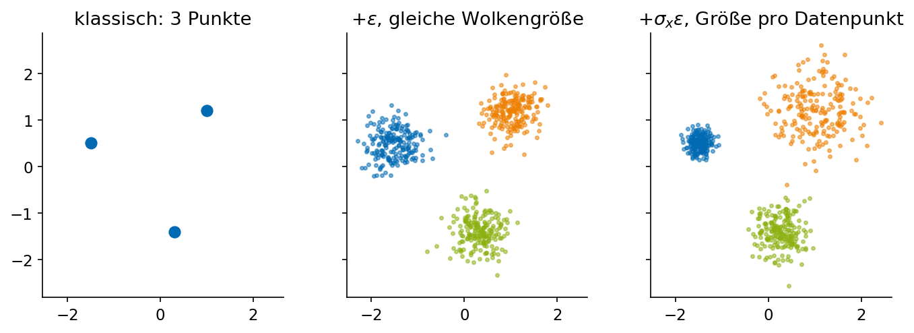
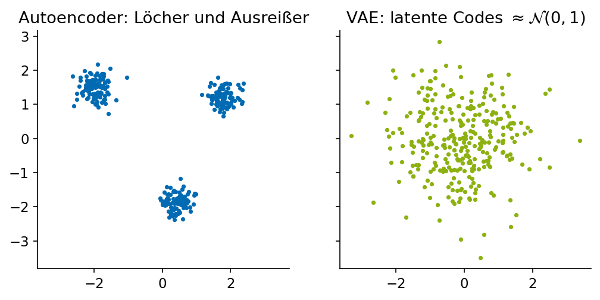

# Variational Autoencoder und latente Räume

## Vom Autoencoder zum VAE

### Motivation: probabilistische Modelle

Beim klassischen Autoencoder bildet der Encoder einen Datenpunkt $x \in D$ auf einen Punkt $\operatorname{enc}(x) \in L$ im latenten Raum ab, der Decoder $y \in L$ auf $\operatorname{dec}(y) \in F$ im Feature-Raum; Ziel ist $\operatorname{MSE}(x, \operatorname{dec}(\operatorname{enc}(x)))$ möglichst klein. Die Modellannahme war aber: Die Punkte $x \in D$ sind eine Stichprobe aus einer *Verteilung*. Können wir die Verteilung direkt mit modellieren, in $\operatorname{enc}(x)$?

**Variation des Ziels**: Auch $\operatorname{MSE}(x, \operatorname{dec}(\operatorname{enc}(x) + \varepsilon))$ soll möglichst klein sein, für einen normalverteilten Fehler $\varepsilon \sim \mathcal{N}(0, 1)$. **Variation des Trainings**: Nach $\operatorname{enc}(x)$ ein $\varepsilon$ sampeln, addieren, dann $\operatorname{dec}$. Der Decoder muss dann nicht nur den Punkt $\operatorname{enc}(x)$, sondern eine ganze Umgebung davon auf $x$ abbilden – der latente Raum wird „glatt“.

Oh: Wie geht Backpropagation für „ein $\varepsilon$ sampeln“? Da $\varepsilon$ nicht von den Gewichten abhängt, ganz normal mit der Kettenregel:

$$
\frac{d}{dw_{\text{enc}}} \operatorname{dec}(\operatorname{enc}(x) + \varepsilon) = \operatorname{dec}'(\operatorname{enc}(x) + \varepsilon) \cdot \frac{d}{dw_{\text{enc}}} \operatorname{enc}(x).
$$

Das gesampelte $\varepsilon$ ist im Rückwärtsdurchlauf einfach eine Konstante.

**Beispiel im latenten Raum.** Mit 3 Datenpunkten: Klassisch sind das 3 Punkte. Mit $+\varepsilon$ werden es 3 Wolken gleicher Größe. Mit $+\sigma\varepsilon$ für einen Skalierungsfaktor $\sigma$ kann man die Wolkengröße steuern. Mit 300 Datenpunkten: Klassisch eine Punktwolke mit Löchern und Ausreißern; gut wäre eine Verteilung, die den latenten Raum lückenlos und gleichmäßig füllt, sodass man an *jeder* Stelle dekodieren kann.

:::{figure}
:width: 90%

Oben: drei Datenpunkte im latenten Raum – klassisch, mit gleichem Rauschen $+\varepsilon$, mit datenabhängigem Rauschen $+\sigma_x\varepsilon$. Unten: 300 Datenpunkte – ein klassischer Autoencoder lässt Löcher und Ausreißer, ein VAE zieht die Codes zur Standardnormalverteilung.
:::

Modelliere die Verteilung also mit einer Gaußschen Mischung im latenten Raum, in der die Störung $\varepsilon$ von den Daten abhängt: Zu jedem Datenpunkt $x \in D$ brauchen wir zusätzlich zu $\operatorname{enc}(x) \in L$ auch eine Standardabweichung $\sigma_x$ (bzw. besser noch eine Kovarianzmatrix $\operatorname{cov}(x)$), dann $\operatorname{dec}(\operatorname{enc}(x) + \varepsilon)$ mit $\varepsilon \sim \mathcal{N}(0, \sigma_x^2)$. Aber Sampling aus einer Verteilung, deren Parameter $\sigma_x$ von den Gewichten abhängen, lässt sich nicht ableiten. **Reparametrisierungstrick**: statt $\varepsilon \sim \mathcal{N}(0, \sigma_x^2)$ besser

$$
y := \operatorname{enc}(x) + \sigma_x \varepsilon, \qquad \varepsilon \sim \mathcal{N}(0, 1),
$$

denn dann ist $\varepsilon$ wieder eine Konstante und $\sigma_x$ ein ganz normaler Ausgang des Encoders, durch den Gradienten fließen.

### Training

Wie trainiert man einen Variational Autoencoder? Für jeden Datenpunkt $x \in D$ berechne $\operatorname{enc}(x) = (\mu_x, \sigma_x)$ – der Encoder hat jetzt $2L$ Ausgänge –, generiere ein $\varepsilon \sim \mathcal{N}(0, 1)$ und setze $y := \mu_x + \sigma_x \varepsilon$. Die Loss-Funktion ist *naiv* $\operatorname{MSE}(x, \operatorname{dec}(y))$. Das hat einen Haken: Das Netz kann $\sigma_x \to 0$ lernen und ist dann wieder ein klassischer Autoencoder.

Stabileres Training mit dem Extra-Term **Variational Loss**:

$$
L_{\text{VAE}} = \operatorname{MSE}(x, \operatorname{dec}(y)) + D_{KL}\bigl( q(y \mid x) \,\|\, \mathcal{N}(0, 1) \bigr),
$$

wobei $q(y \mid x) = \mathcal{N}(\mu_x, \sigma_x^2)$ die Dichte der latenten Verteilung für ein festes $x$ ist. Dabei sind die beiden Standardnormalverteilungen – das $\mathcal{N}(0,1)$ für $\varepsilon$ und das $\mathcal{N}(0,1)$ im KL-Term – nicht „dieselben“!! Die erste ist die Rauschquelle, die zweite ist die *Prior*-Verteilung, an die sich die Gesamtheit der latenten Verteilungen anschmiegen soll, damit der latente Raum um den Ursprung herum lückenlos gefüllt ist. In der Praxis lässt man den Encoder statt $\sigma_x$ den Logarithmus der Varianz ausgeben, $\ell_x := \ln \sigma_x^2$ (im Code meist `logvar`), damit kein Ausgang auf positive Werte eingeschränkt werden muss; dann ist $\sigma_x = \exp(\ell_x / 2)$. Für Normalverteilungen hat der KL-Term eine geschlossene Form:

$$
D_{KL}\bigl( \mathcal{N}(\mu, \sigma^2) \,\|\, \mathcal{N}(0, 1) \bigr) = \tfrac12 \left( \mu^2 + \sigma^2 - 1 - \ln \sigma^2 \right).
$$

Diese Loss-Funktion ist genau der negative **ELBO** (evidence lower bound) $\mathcal{L}(\theta, q)$ aus dem Kapitel „Expectation Maximization“ in Data Science.

### Recap

Ein VAE ist ein Autoencoder, dessen Encoder statt eines Punkts eine Normalverteilung im latenten Raum ausgibt, dessen Decoder aus einer Stichprobe daraus rekonstruiert, und dessen Loss die Rekonstruktion plus die KL-Divergenz zum Standardnormal-Prior ist. Danach kann man neue Daten generieren, indem man $y \sim \mathcal{N}(0, 1)$ sampelt und dekodiert. Schön zusammengefasst in Lilian Wengs Blogpost [From Autoencoder to Beta-VAE](https://lilianweng.github.io/posts/2018-08-12-vae/). VAEs sind heute noch eine Komponente der Bildgeneratoren (DALL-E, Midjourney, Stable Diffusion): Die Diffusion findet im latenten Raum eines VAE statt.

:::{figure} ../images/vl08-vae-schema.png
:width: 90%

Der Variational Autoencoder mit Reparametrisierungstrick: Der Encoder liefert $\mu_x$ und $\sigma_x$, das Rauschen $\varepsilon$ ist eine Konstante für die Backpropagation, der KL-Term zieht die Codes zum Prior.
:::

## Latente Räume für Bilder: AE, VAE, GAN

### Erinnerung: kontinuierlich statt diskret

Bei word2vec und LLMs können nur $N$ Vektoren dekodiert werden. Bei Autoencodern für Bilder ist dies anders: *Jeder* Vektor im Latent Space lässt sich zu einem Bild dekodieren. Damit lässt sich z.B. zwischen Hund und Katze interpolieren – der Decoder produziert für $t \cdot \operatorname{enc}(\text{Hund}) + (1 - t) \operatorname{enc}(\text{Katze})$ tatsächlich ein Bild, ob es sinnvoll aussieht, ist eine andere Frage.

:::{figure} ../images/vl13-latent-interpolation.png
:width: 90%

Lineare Interpolation zwischen den Codes einer 3 und einer 8 im latenten Raum eines linearen Autoencoders (PCA mit 16 Komponenten auf den 8×8-Ziffern aus scikit-learn): Jeder Zwischenpunkt ist ein Bild.
:::

### Autoencoder vs. GANs

Der Generator eines GANs ist typischerweise gegeben durch eine Verteilung auf einem Latent Space, aus der gesampelt wird (i.d.R. eine Standardnormalverteilung), und einen Decoder, der aus dem latenten Vektor ein tatsächliches Bild generiert. Um einen guten Decoder zu bekommen, ist vor dem adversarial Training ein Pretraining in einem Autoencoder-Setup sinnvoll; daher ist der Latent Space zunächst derselbe. Nach dem GAN-Training des Decoders passen Encoder und Decoder aber nicht mehr zusammen, d.h. der Rekonstruktions-Loss steigt, während der Adversarial Loss sinkt. Der GAN-Decoder optimiert „sieht echt aus“, nicht „ist das Original“.

### Autoencoder vs. VAE

Der Encoder eines VAE kodiert ein Eingabebild $x$ als Paar $(v_x, \sigma_x)$, wobei $v_x \in \mathbb{R}^n$ ein latenter Vektor wie beim Autoencoder ist. Der Unterschied vom VAE zum AE liegt im Training: Statt $\operatorname{decode}(v_x)$ mit $x$ zu vergleichen, wird $\operatorname{decode}(v_x + \varepsilon)$ mit $x$ verglichen, wobei $\varepsilon$ Varianz $\sigma_x^2$ hat. Nach erfolgreichem Training ist dann auch $\operatorname{decode}(v_x) \approx x$, aber der Latent Space bzw. Decoder sieht anders aus als beim AE: Um jeden Code herum gibt es eine Umgebung, die ebenfalls zu einem ähnlichen Bild dekodiert.

Häufig wird zusätzlich zum $+\varepsilon$-Trick auch noch ein Summand zur Loss-Funktion hinzugefügt, damit die Codes der Trainingsdaten im Latent Space ungefähr standardnormalverteilt sind (Variational Loss, siehe oben). So kann man später aus der Standardnormalverteilung im Latent Space sampeln und bleibt in der gelernten Verteilung.

### Arvanitidis et al. 2017: Latent Space Oddity

*Latent Space Oddity: on the Curvature of Deep Generative Models* (ICLR 2018): Der latente Raum eines VAE sieht flach aus, aber der Decoder verzerrt ihn – die euklidische Gerade zwischen zwei Codes ist nicht der kürzeste Weg im *Bildraum*. Die richtige Geometrie ist die durch den Decoder induzierte Riemannsche Metrik, und Geodäten darin laufen um Regionen herum, in denen der Decoder unsicher ist (`arvanitidis2021-latent-space-oddity-figure1.png`). Praktisch: Interpolationen entlang Geodäten sehen besser aus als lineare.

:::{figure} ../images/vl13-arvanitidis-fig1.png
:width: 90%

Figure 1 aus Arvanitidis, Hansen, Hauberg: *Latent Space Oddity* (ICLR 2018): Die Gerade im latenten Raum (links) und die Geodäte bezüglich der vom Decoder induzierten Metrik führen zu unterschiedlichen Interpolationen.
:::
