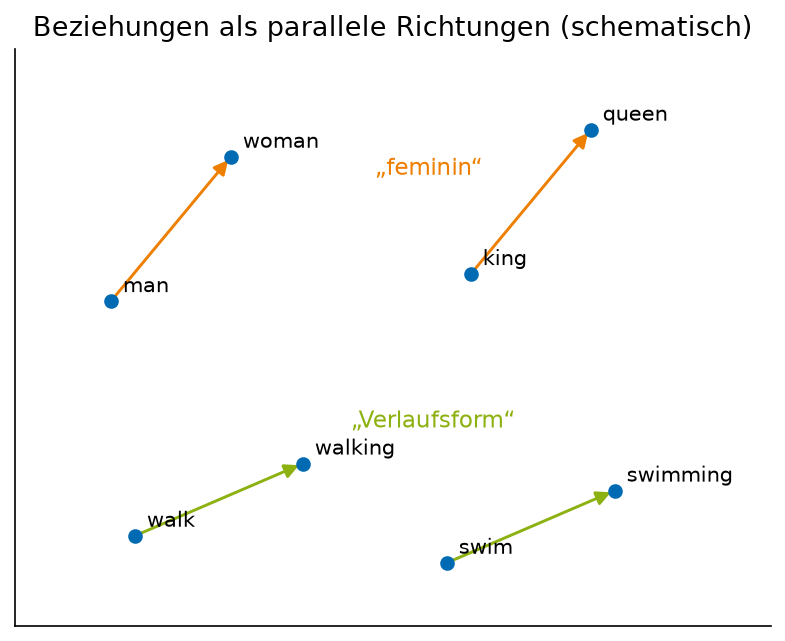
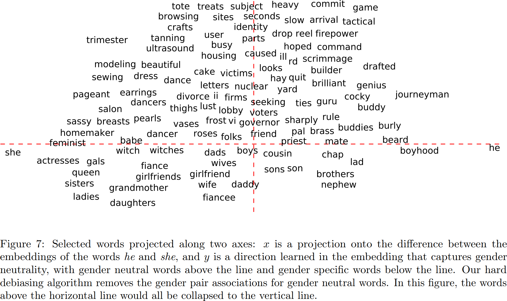

# Wortvektoren: word2vec

## word2vec

### Von der Anwendung her gedacht

Ein Beispiel-Task, unsupervised mit neuronalen Netzen: Alle Dokumente $D_i$ einlesen als Liste von Wörtern (getrennt an Leerzeichen, Satzzeichen entfernt), dann jedes einzelne Wort mit einem zuvor trainierten neuronalen Netz umrechnen in eine andere Repräsentation, die sich besser vergleichen lässt. Die andere Repräsentation verschaffen wir uns durch latente Vektoren aus einem Autoencoder. Das ist die Idee von **word2vec** (Mikolov et al., Google, 2013).

### Vorverarbeitung und Ziel

1. Wir zählen alle Wörter (bzw. Token) im Korpus,
2. entfernen Stopwords und sortieren nach Häufigkeit,
3. behalten die häufigsten $N$ Wörter (z.B. $N = 5000$),
4. kodieren diese mit One-Hot-Encoding als Vektoren in $\mathbb{R}^N$,
5. mit dem Ziel, eine Abbildung $e \colon \mathbb{R}^N \to \mathbb{R}^K$ zu finden, $K \ll N$ (z.B. $K = 200$),
6. mit einer „Decoder“-Abbildung $d \colon \mathbb{R}^K \to \mathbb{R}^N$, sodass $d(e(w)) = w$ für alle $N$ Wörter unserer Liste gilt,
7. und semantisch ähnliche Wörter $w_1, w_2$ nach Kodieren in $\mathbb{R}^K$ einen kleinen Abstand $\operatorname{d}(e(w_1), e(w_2)) \approx 0$ haben.

Punkt 6 allein wäre ein gewöhnlicher Autoencoder auf One-Hot-Vektoren – und der lernt nichts über Bedeutung, denn One-Hot-Vektoren sind alle gleich weit voneinander entfernt. Punkt 7 ist der Clou.

### Kernidee

Die Semantik eines Wortes ergibt sich durch seine Nutzung in Sätzen (*distributional hypothesis*). Beispiel: „Die [MASK] frisst ihr Futter am liebsten aus dem goldenen Napf“ kommt in Texten mit [MASK] = Katze und [MASK] = Hündin vor. Der Machine-Learning-Task, unsupervised: Gegeben Text, ersetze ein Wort durch [MASK] und lasse vorhersagen, was [MASK] ist – wie ein Denoising Autoencoder, bei dem das Rauschen im Löschen eines Wortes besteht.

**CBOW** (Continuous Bag of Words, für kleinere Korpora). Hyperparameter ist die Fenstergröße $S$ (window size), z.B. $S = 2$. Eingabe: $2S + 1$ Token, die hintereinander im Text vorkommen, dabei das mittlere durch [MASK] ersetzt – also $2S$ One-Hot-Vektoren. Ausgabe: eine Wahrscheinlichkeitsverteilung auf allen $N$ Wörtern. Loss-Funktion: negative Log-Likelihood (NLL), d.h. Vergleich der ausgegebenen Verteilung mit dem One-Hot-Vektor für das Wort, welches sich hinter [MASK] verbirgt. Architektur: 1 Hidden Layer mit $K$ Neuronen, der „Encoder“ $W \in \mathbb{R}^{K \times N}$, angewendet auf alle $2S$ Kontextwörter und dann gemittelt (*averaging*), danach ein Layer „Decoder“ $W' \in \mathbb{R}^{N \times K}$ gefolgt von Softmax:

$$
P(w_{\text{mitte}} \mid \text{Kontext}) = \operatorname{sm}\Bigl( W' \cdot \frac{1}{2S} \sum_{j \in \text{Kontext}} W w_j \Bigr).
$$

Die Wortvektoren sind die Spalten von $W$: $e(w) = W w$ ist für einen One-Hot-Vektor $w$ einfach die entsprechende Spalte.

**Skip-gram**, die Alternative zu CBOW: Gegeben ein Token, sage den Kontext vorher. Eingabe: das mittlere Token als One-Hot-Vektor für eine Abfolge von $2S + 1$ Token. Ausgabe: eine Wahrscheinlichkeitsverteilung auf allen $N$ Token. Loss-Funktion: NLL, d.h. Vergleich der ausgegebenen Verteilung mit der Summe der One-Hot-Vektoren für alle $2S$ Kontexttoken. Architektur: 1 Hidden Linear Layer mit $K$ Neuronen (der „Encoder“), danach ein Layer „Decoder“ mit $N$ Neuronen gefolgt von Softmax. Skip-gram funktioniert bei großen Korpora und seltenen Wörtern besser.

:::{figure} ../images/vl08-cbow-skipgram.png
:width: 90%

CBOW und Skip-gram: dieselben zwei Matrizen $W$ (Encoder, $N \to K$) und $W'$ (Decoder, $K \to N$), einmal von mehreren Kontextwörtern auf ein Wort, einmal umgekehrt.
:::

### word2vec benutzen

Verfügbare Gewichte $W$ gibt es mit Gensim (z.B. `wiki-english-20171001`) oder von Hugging Face (z.B. [word2vec-google-news-300](https://huggingface.co/fse/word2vec-google-news-300), $N = 3$ Millionen, $K = 300$). Klappt nicht gut? Drop-in-Ersatz für word2vec ist Facebooks **fastText**, welches hauptsächlich einen geeigneteren Tokenizer benutzt (Stichwort Subword-Tokenization) und dadurch auch mit unbekannten Wörtern umgehen kann.

### word2vec selbst trainieren (ein ganz knapper Überblick)

Zutatenliste: Keine GPU oder andere Beschleuniger zur Hand? Google Colab oder CPU reicht. Input: ein Textkorpus zum Training, eine Tokenization-Strategie bzw. ein Tokenizer (darüber sprechen wir noch), die Dimension $K$ des Latent Space, CBOW oder Skip-gram (wie groß ist der Korpus?), von Grund auf trainieren (Pretraining) oder Finetuning, und welche Implementierung?

* **Gensim** ([Tutorial](https://radimrehurek.com/gensim/auto_examples/tutorials/run_word2vec.html#training-your-own-model)). Pro: NLP-Gesamtlösung, gut dokumentiertes Paket. Contra: keine GPU-Beschleunigung (aber für word2vec ist das „egal“), und keine Kombination von word2vec im Training mit anderen Tasks (wie wir es beim Denoising Label Autoencoder getan haben).
* **PyTorch**, „so richtig von Hand“: [Skip-gram implementation step by step](https://www.kaggle.com/code/karthur10/skip-gram-implementation-with-pytorch-step-by-step/notebook); oder mit dem `torch.nn.Embedding`-Layer (das ist genau die Matrix $W$, mit One-Hot-Multiplikation als Lookup implementiert): [word2vec from scratch](https://muhark.github.io/python/ml/nlp/2021/10/21/word2vec-from-scratch.html), [d2l.ai](https://d2l.ai/chapter_natural-language-processing-pretraining/word2vec-pretraining.html).

Wozu? Durch Pretraining oder Finetuning von word2vec-Modellen mit PyTorch bekommt man Wortvektoren, die auf die eigene Domäne (Fachsprache, andere Sprache) passen, und kann sie als erste Schicht in ein größeres Modell einbauen.

## Von Wörtern zu Dokumenten: NLP

### Beispiel-Task: ähnliche Dokumente finden

Gegeben ist eine Menge von $N$ (kurzen) Dokumenten $\{D_1, \dots, D_N\}$ (z.B. Tweets, Webseiten, Hausarbeiten). Gesucht sind $k$ Paare ähnlicher Dokumente ($k \ll N$), z.B. um Tweets thematisch zu gruppieren oder Plagiate zu finden: $\{(x_1, y_1), \dots, (x_k, y_k)\}$, Paare von Indizes, sodass $D_{x_i}$ und $D_{y_i}$ ähnlich sind.

**Klassischer Ansatz**: Wörter in $D_i$ zählen, Häufigkeitsverteilungen von $D_i$ und $D_j$ vergleichen (*bag of words*). Probleme mit diesem Ansatz:

1. „Katze isst Maus“ und „Maus isst Katze“ sind ununterscheidbar.
2. „Schwimmen“ und „schwamm“ haben nichts miteinander zu tun.
3. „Hund“ und „Tier“ haben nichts miteinander zu tun.
4. Wörter wie „der“, „die“, „das“ sind sehr häufig, aber bedeutungslos.

Klassische Lösungsansätze: (1) $n$-Gramme statt Wörter betrachten, (2) Lemmatisierung, (3) komplexe Ontologien (formalisiertes Wissen), (4) Stopwords entfernen.

### Wörter? Token!

Alternative Lösung zu Problem 2 (statt Lemmatisierung): Buchstaben bzw. Zeichen anstelle von Wörtern als „Atome“ (= Token) nehmen, und $n$-Gramme davon (z.B. Trigramme, $n = 3$). Beispiel: „schwimm!“ und „schwimmen“ ergeben

$$
[\text{sch}, \text{chw}, \text{hwi}, \text{wim}, \text{imm}, \text{mm!}] \quad\text{und}\quad [\text{sch}, \text{chw}, \text{hwi}, \text{wim}, \text{imm}, \text{mme}, \text{men}],
$$

die haben sehr ähnliche Trigrammhäufigkeitsverteilungen. Konkret zu klärende Fragen: Leerzeichen wie jedes andere Zeichen behandeln? Über das Satzende „.“ hinaus? Flexibles $n$, z.B. Silben statt Buchstabentrigramme? Die Antworten darauf bilden die **Tokenisierungsstrategie**, den Tokenizer. Der Einfachheit halber bleiben wir zunächst bei Token = Wörter, d.h. wir löschen Satzzeichen und trennen an Leerzeichen; Byte Pair Encoding, der Tokenizer moderner LLMs, kommt im [Kapitel „Sequenzen: RNNs und Transformer“](13-sequenzen-rnn-transformer.md).

**Modernerer Ansatz (supervised)**: mit einem neuronalen Netz; Menschen labeln Ähnlichkeit. Eingabe: Paare $(D_i, D_j)$, Ausgabe: Ähnlichkeitsschätzung. **Unsupervised mit neuronalen Netzen**:

1. Alle Dokumente $D_i$ einlesen als Liste von Wörtern.
2. Jedes einzelne Wort mit einem zuvor trainierten neuronalen Netz (word2vec) umrechnen in eine andere Repräsentation, die sich besser vergleichen lässt.
3. Für jedes Paar $(D_i, D_j)$ die Listen von Repräsentationen vergleichen (z.B. Kosinus-Ähnlichkeit der Mittelwerte), daraus ein Ähnlichkeitsmaß für das Paar berechnen.
4. Die Top-$k$ ähnlichsten Paare ausgeben.

Problem 3 („Hund“ und „Tier“) löst word2vec, weil beide in ähnlichen Kontexten vorkommen und daher nahe beieinander liegen. Problem 1 (Wortreihenfolge) löst es nicht – dafür braucht man Modelle, die Sequenzen verarbeiten ([Kapitel „Sequenzen“](13-sequenzen-rnn-transformer.md)).

### Literatur und Softwarepakete

* Das modernste Lehrbuch ist Dan Jurafsky, James H. Martin: *Speech and Language Processing*. Es gibt einen „Third Edition Draft“ frei verfügbar: [web.stanford.edu/~jurafsky/slp3/](https://web.stanford.edu/~jurafsky/slp3/).
* Das Python Natural Language Toolkit (NLTK), [nltk.org/book](https://www.nltk.org/book/), enthält z.B. den PunktTokenizer, der so arbeitet wie wir jetzt.
* Radim Řehůřeks (& Koautoren) gensim-Bibliothek für Python, [radimrehurek.com/gensim](https://radimrehurek.com/gensim/auto_examples/index.html).

## Wortvektoren geometrisch verstehen

### Arithmetik im Latent Space

Der Klassiker bei word2vec: KING − MAN + WOMAN = QUEEN. Also ist WOMAN − MAN die Richtung „feminin“. Auch:

* PARIS − FRANCE + ITALY = ROME (also PARIS − FRANCE die Richtung „Hauptstadt“),
* WALKING − WALK + SWIMMING = SWAM (also WALKING − WALK die Richtung „Vergangenheit“ bzw. Flexion),
* BIGGER − BIG = BIGGEST − BIGGER (also Steigerung der Intensität als Richtung).

Analog, aber in allen LLMs: Semantische Beziehungen werden zu *Richtungen* im latenten Raum, und Richtungen kann man addieren. Das ist keine Eigenschaft, auf die word2vec trainiert wurde, sie entsteht von selbst aus dem Kontext-Vorhersage-Training.

:::{figure}
:width: 90%

Oben: Beziehungen zwischen Wörtern als parallele Richtungen im Vektorraum (schematisch). Unten: Figure 7 aus Bolukbasi et al. 2016 – Berufe, projiziert auf die Gender-Richtung.
:::

**Bolukbasi et al. 2016, *Man is to Computer Programmer as Woman is to Homemaker? Debiasing Word Embeddings***: Dieselbe Arithmetik findet auch MAN − WOMAN ≈ COMPUTER PROGRAMMER − HOMEMAKER. Die Embeddings enthalten die Stereotype des Trainingskorpus als Richtungen, und man kann sie messen – und, das ist der Beitrag des Papers, durch Projektion auf das orthogonale Komplement der Gender-Richtung teilweise entfernen (`bolukbasi16-man-is-to-computer-programmer-figure7.png`).

### Interpolation und Superposition

Ein Vektor im Latent Space ist ausdrucksstärker als ein Token, er kann interpolieren und Superposition ausdrücken: Statt „Katze“ oder „Hund“ geht auch $\tfrac12 \text{Katze} + \tfrac12 \text{Hund}$, oder auch $t \cdot \text{Katze} + (1 - t) \cdot \text{Hund}$. Aber: $\operatorname{decode}(t \cdot \text{Katze} + (1 - t) \cdot \text{Hund})$ ist entweder Katze oder Hund, es gibt kein „dazwischen“-Token außerhalb des Vokabulars.

### Diskreter Latent Space

Bei word2vec und LLMs mit einem Vokabular von $N$ Token können nur genau $N$ Vektoren im Latent Space direkt zu Token dekodiert werden; für jeden anderen Vektor werden nahe liegende solche Vektoren ausgewählt zum Dekodieren. Gegeben ein Vektor im Latent Space, welches Token wählen wir aus? Das ist die **Sampling-Strategie**.

Gegeben Vektor $v \in \mathbb{R}^n$, welches Token $t \in$ Vokabular wählen wir?

* Berechne für jedes $t$ den Abstand $d(v, \operatorname{code}(t))$, z.B. im Kosinus-Abstand $1 - \cos(\angle(v, \operatorname{code}(t)))$, und wähle $t$, sodass dieser Abstand minimal wird (**top-1**, *greedy decoding*).
* Betrachte auf allen Token $t$ die Verteilung $\operatorname{Softmax}(-d(v, \operatorname{code}(t)))$ und **sample** aus dieser Verteilung.
* Für eine natürliche Zahl $k$ (z.B. $k = 5$) wähle die $k$ nächstgelegenen Token $t_1, \dots, t_k$ aus und sample mit der Softmax-Verteilung nur aus $\{t_1, \dots, t_k\}$ (**top-k sampling**; *top-p* nimmt stattdessen so viele Token, bis ihre Wahrscheinlichkeit $p$ überschreitet).
* Verändere die Verteilung: Richtung top-1 durch niedrige Temperatur, Richtung Gleichverteilung durch hohe Temperatur.

**Temperature Scaling**: Gegeben eine Temperatur $T > 0$, berechne die Verteilung

$$
P_i = \frac{\exp(v_i / T)}{\sum_j \exp(v_j / T)},
$$

d.h. die Einträge von $v$ (die Logits) werden durch $T$ geteilt, dann wird mit Softmax eine Wahrscheinlichkeitsverteilung daraus. Großes $T > 1$: Die verschiedenen $P_i$ werden sich ähnlicher, das Modell wird „kreativer“ (und fehleranfälliger). Kleines $T < 1$: Die großen $P_i$ werden größer, die kleinen $P_i$ werden kleiner; im Grenzfall $T \to 0$ ist es top-1.
